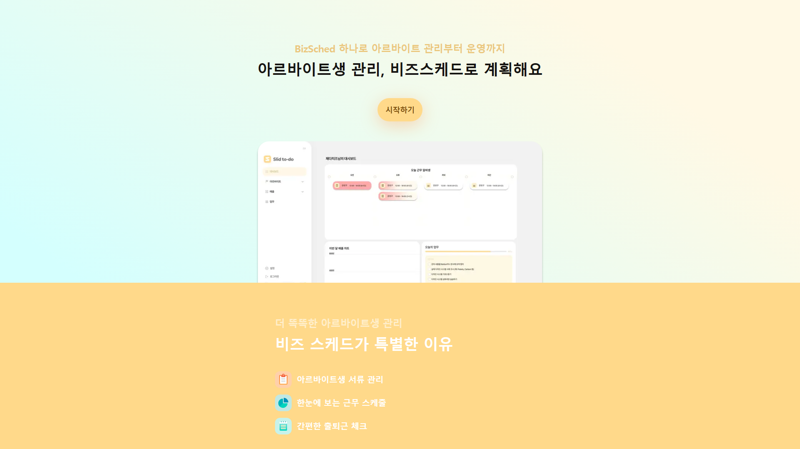
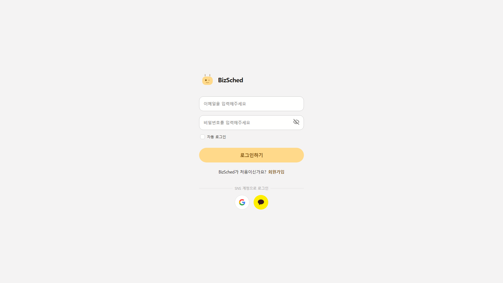
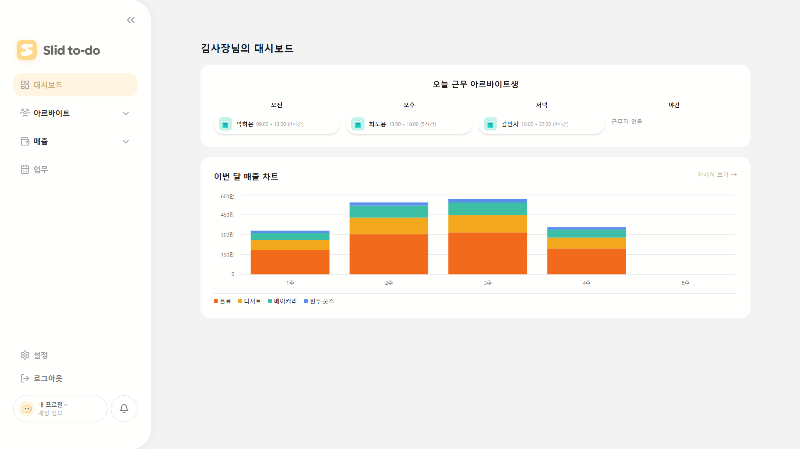
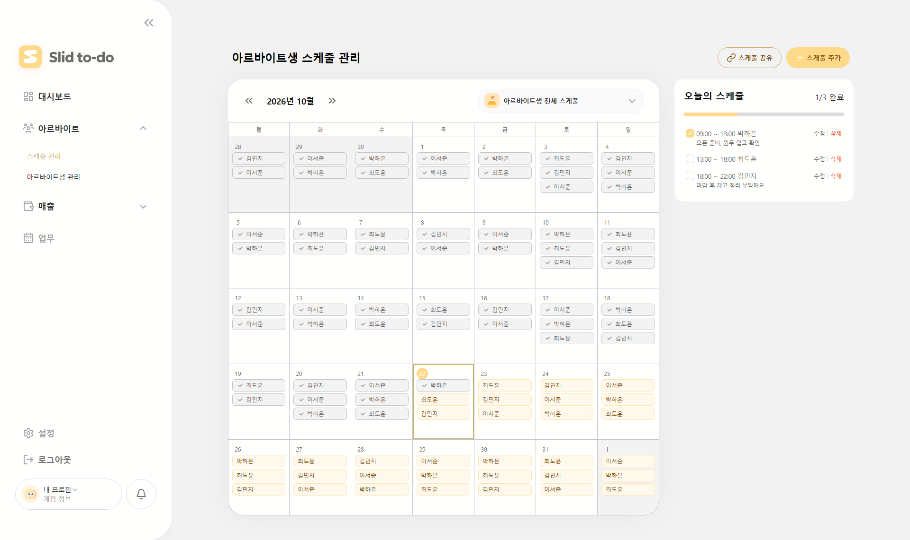
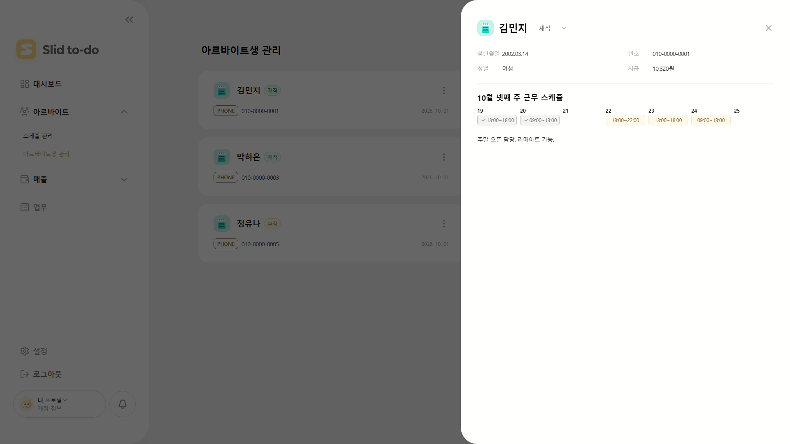
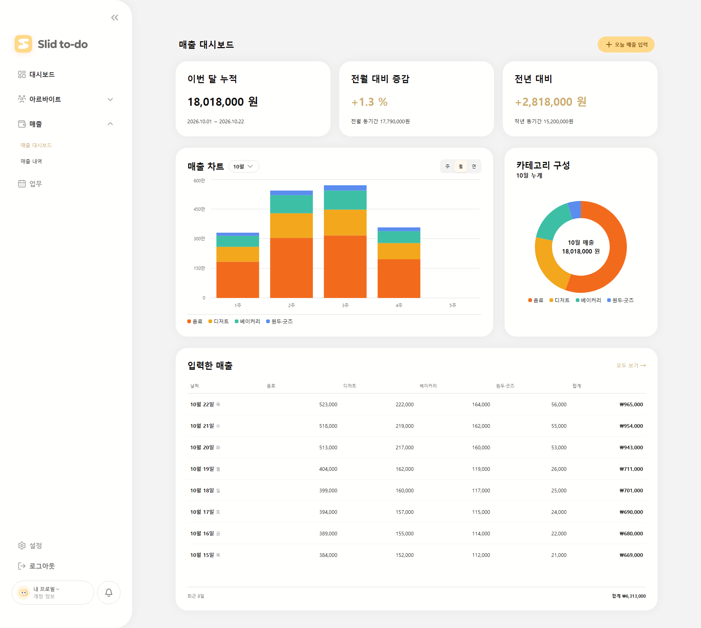
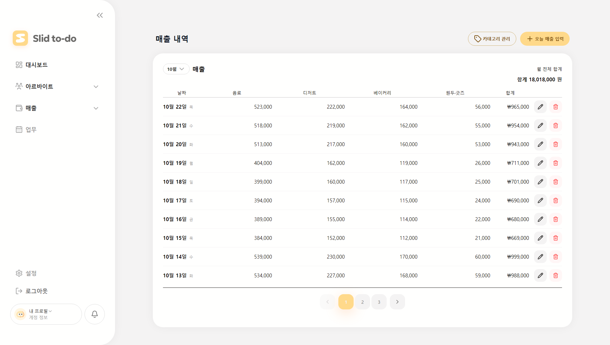
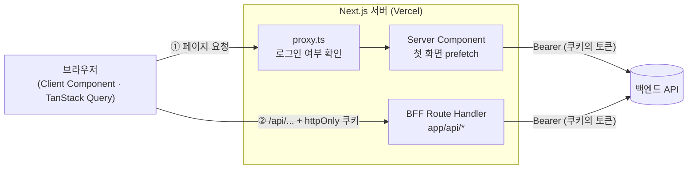
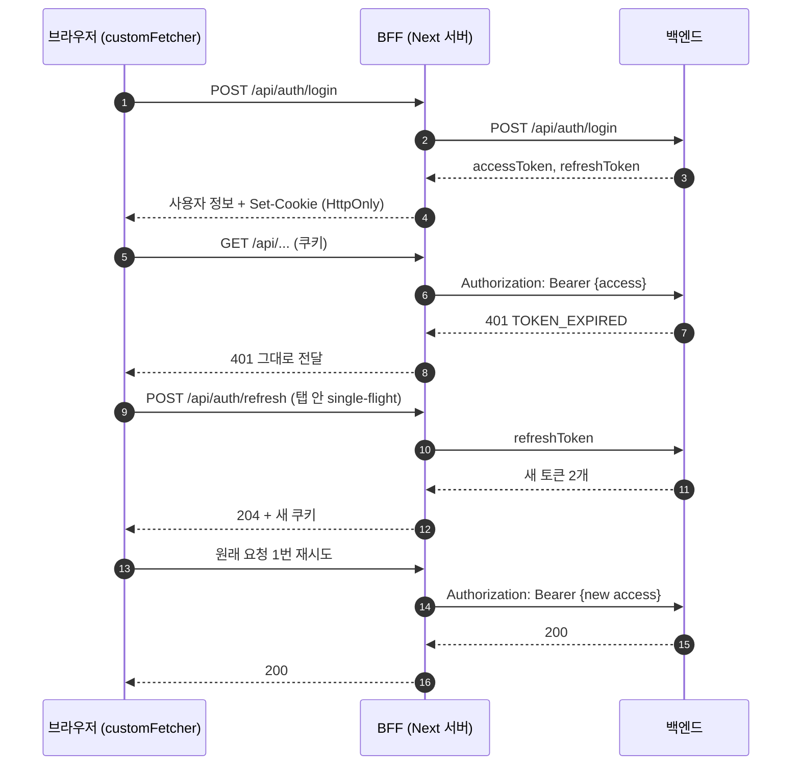
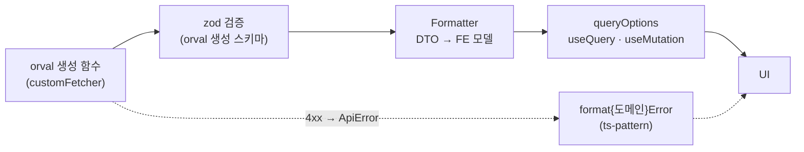

# BizSched (비즈스케드)

> 아르바이트생 관리부터 운영까지, 비즈스케드로 계획해요

사장님이 아르바이트생, 근무 스케줄, 매출을 한곳에서 관리하는 매장 운영 관리 서비스의 프론트엔드 저장소입니다.



| 구분            | 링크                                 |
| --------------- | ------------------------------------ |
| 배포 주소       | https://bizsched.vercel.app          |
| 프론트엔드 레포 | https://github.com/BizSched/frontend |
| 백엔드 레포     | 비공개                               |
| 프로젝트 문서   | [docs/README.md](./docs/README.md)   |

<br />

## 프로젝트 소개

| 항목      | 내용                                |
| --------- | ----------------------------------- |
| 개발 기간 | 2026.09.10 ~ 2026.10.23 (약 1달 반) |
| 구성      | 프론트엔드 3명, 백엔드 팀과 협업    |

### 개발 목적

BizSched는 할 일 관리(todo) 서비스를 바탕으로, 매장을 운영하는 사장님에게 필요한 기능을 더한 운영 관리 시스템입니다.

할 일과 일정을 정리하는 todo 서비스의 구조를 매장 운영에 맞게 넓혔습니다. 사장님이 매일 챙기는 일은 크게 세 가지입니다.

- **사람**: 아르바이트생의 인적 사항과 근로 서류 보관
- **시간**: 누가 언제 근무하는지, 실제로 출근했는지 확인
- **돈**: 매출 기록과 흐름 파악

이 일들은 보통 메신저, 엑셀, 종이 장부에 흩어져 있습니다. BizSched는 이를 하나의 서비스로 모아, 로그인하면 대시보드에서 오늘 근무자와 이번 달 매출을 바로 확인할 수 있게 합니다.

<br />

## 팀원 및 역할

| 이름   | 파트 | 담당                                                                                                                                                                                                                                                                                              | GitHub                                   |
| ------ | ---- | ------------------------------------------------------------------------------------------------------------------------------------------------------------------------------------------------------------------------------------------------------------------------------------------------- | ---------------------------------------- |
| 정예은 | FE   | 아르바이트 도메인 전체(스케줄 관리, 아르바이트생 목록·상세·추가·수정), 인증(로그인·회원가입·소셜 로그인·온보딩), BFF·인증 인프라(Route Handler, 쿠키, refresh, 라우트 가드), 공통 컴포넌트(Button 계열, Dropdown 계열, DatePicker, Checkbox, Radio, Badge, ActionButton), 아르바이트·회원가입 e2e | [@b1uey0](https://github.com/b1uey0)     |
| 김예림 | FE   | 매출 도메인 전체(매출 대시보드, 매출 내역, 카테고리), 메인 대시보드, 랜딩 페이지, 공통 컴포넌트(Chart, Sidebar, Input, Card, Table, Calendar, Toast), 개발 환경·CI(ESLint·Prettier·Husky, GitHub Actions, Storybook·Chromatic, orval 코드젠, Playwright 환경)                                     | [@kimyeyer](https://github.com/kimyeyer) |
| 강성구 | FE   | 협업 기반(이슈·PR 템플릿, 커밋 메시지·코드 리뷰 스킬, 컨벤션 문서), 프로젝트 폴더 구조·path alias, 공통 컴포넌트(Modal, Pagination)                                                                                                                                                               | [@L1m3Kun](https://github.com/L1m3Kun)   |

<br />

## 주요 기능

> 아래 화면의 이름·전화번호·매출은 모두 예시 데이터입니다.

### 인증

- 이메일·비밀번호 로그인과 자동 로그인
- 일반 회원가입 (계정 정보, 업종, 약관 동의)
- 카카오·구글 소셜 로그인과, 처음 가입할 때 업종·약관을 받는 온보딩
- 로그인하지 않은 사용자는 보호 페이지에 들어갈 수 없음



### 대시보드 (`/dashboard`)

- 오늘 근무할 아르바이트생을 오전·오후·저녁·야간으로 나눠 표시
- 이번 달 주차별 매출을 카테고리별 누적 막대 차트로 표시



### 아르바이트생 스케줄 관리 (`/partTime/schedule`)

- 월 캘린더로 근무 스케줄 조회, 아르바이트생별 필터
- 스케줄 추가·수정·삭제, 메모
- 날짜별 출근 확인



### 아르바이트생 관리 (`/partTime/staff`)

- 카드 목록과 상세 보기 (인적 사항, 이번 주 근무, 첨부파일, 메모)
- 아르바이트생 추가·수정 (`/partTime/staff/new`, `/partTime/staff/[id]/edit`)
- 근로계약서 등 첨부파일 업로드·미리보기·다운로드
- 근무 상태 변경, 삭제



### 매출 관리

- **매출 대시보드** (`/sales/dashboard`): 매출 요약, 기간별 추이 차트, 카테고리 구성, 최근 입력 내역
- **매출 내역** (`/sales/details`): 월별 합계와 날짜별 기록 조회, 매출 추가·수정·삭제
- 매출 카테고리 추가·이름 변경





### 랜딩 페이지 (`/`)

- 서비스 소개와 시작하기 CTA

### 예정 기능

- **업무 관리 (task)**: 업무 캘린더, 업무 등록, 업무 상세. 폴더만 만들어 두었고 아직 구현하지 않았습니다.

<br />

## 기술 스택

| 구분                     | 기술                                                                                        |
| ------------------------ | ------------------------------------------------------------------------------------------- |
| 언어                     | TypeScript 5                                                                                |
| 프레임워크               | Next.js 16 (App Router), React 19                                                           |
| 스타일링                 | Tailwind CSS v4, shadcn/ui (Base UI 기반), class-variance-authority, cn                     |
| 서버 상태                | TanStack Query v5                                                                           |
| 클라이언트 상태          | React Context, Zustand                                                                      |
| 폼·검증                  | React Hook Form, zod v4                                                                     |
| API 타입·클라이언트 생성 | orval (fetch 클라이언트 + zod 스키마)                                                       |
| 데이터 페칭              | fetch API (axios 미사용)                                                                    |
| 조건 분기                | ts-pattern                                                                                  |
| UI 라이브러리            | overlay-kit(모달), sonner(토스트), recharts(차트), react-day-picker, date-fns, lucide-react |
| 테스트                   | Vitest, Testing Library, Playwright(e2e), Storybook, Chromatic                              |
| 코드 품질                | ESLint, Prettier, Husky, lint-staged                                                        |
| CI/CD                    | GitHub Actions, Vercel                                                                      |
| 알림                     | Discord                                                                                     |

<br />

## 시작하기

### 요구 환경

- Node.js 22.x (CI 기준)
- pnpm 12.3.4 (`package.json`의 `packageManager`)

### 설치 및 실행

```bash
# 1. 의존성 설치
pnpm install

# 2. 환경 변수 파일 만들기 (값은 팀 내부에서 전달받기)
cp .env.template .env.local

# 3. 개발 서버 실행 (http://localhost:3000)
pnpm dev
```

> `pnpm dev`는 실행 전에 `predev`로 orval을 먼저 돌립니다. orval은 `BE_BASE_URL`의 OpenAPI 명세를 받아 `src/lib/api/generated/`를 다시 만들기 때문에, `BE_BASE_URL`이 없거나 백엔드에 연결할 수 없으면 개발 서버가 시작되지 않습니다.

### 주요 스크립트

| 명령어                              | 설명                                            |
| ----------------------------------- | ----------------------------------------------- |
| `pnpm dev`                          | API 코드 생성 후 개발 서버 실행                 |
| `pnpm build` / `pnpm start`         | 프로덕션 빌드 / 실행                            |
| `pnpm lint`                         | ESLint 검사                                     |
| `pnpm type-check`                   | 라우트 타입 생성 후 TypeScript 검사             |
| `pnpm test`                         | Vitest 단위·컴포넌트 테스트                     |
| `pnpm test:e2e`                     | Playwright e2e 테스트                           |
| `pnpm storybook`                    | Storybook 실행 (http://localhost:6006)          |
| `pnpm generate:api`                 | BE OpenAPI 명세로 API 함수·zod 스키마 다시 생성 |
| `pnpm format` / `pnpm format:check` | Prettier 적용 / 검사                            |

e2e 테스트는 처음 한 번 브라우저를 설치해야 합니다.

```bash
pnpm exec playwright install chromium firefox webkit
```

### 환경 변수

`.env.template`을 복사해 `.env.local`에 값을 채웁니다. 모든 값은 **서버 전용**이며, 브라우저 번들에 포함되지 않습니다.

| 키                           | 용도                                                                                              |
| ---------------------------- | ------------------------------------------------------------------------------------------------- |
| `BE_BASE_URL`                | 백엔드 API base URL. 서버 요청과 orval 코드 생성에 사용                                           |
| `KAKAO_CLIENT_ID`            | 카카오 REST API 키 (소셜 로그인 인가 요청)                                                        |
| `GOOGLE_CLIENT_ID`           | 구글 OAuth 클라이언트 ID (소셜 로그인 인가 요청)                                                  |
| `OAUTH_REDIRECT_ORIGIN`      | 소셜 로그인 콜백 origin. 로컬은 `http://localhost:3000`. 백엔드의 `redirect_uri` 설정과 같아야 함 |
| `E2E_EMAIL` / `E2E_PASSWORD` | e2e 테스트 전용 계정                                                                              |

- 브라우저에서 읽어야 하는 값은 `NEXT_PUBLIC_` 접두사를 붙입니다. 이 값은 클라이언트 JS에 그대로 들어가므로 secret·token을 넣지 않습니다.
- 자세한 규칙은 [docs/architecture/env.md](./docs/architecture/env.md)를 참고하세요.

<br />

## 폴더 구조

```
├── app/                    # Next.js App Router 라우트
│   ├── (main)/             # 로그인 후 페이지 (사이드바 레이아웃)
│   │   ├── dashboard/
│   │   ├── partTime/       # schedule/, staff/ (new, [id]/edit)
│   │   └── sales/          # dashboard/, details/
│   ├── api/                # BFF Route Handler (인증 전용 경로 + 범용 통과 [...path])
│   ├── oauth/[provider]/   # 소셜 로그인 콜백
│   ├── login/ signup/ onboarding/
│   └── page.tsx            # 랜딩 페이지
├── proxy.ts                # 라우트 가드 (refresh 쿠키로 로그인 여부 판단)
├── src/
│   ├── assets/             # 아이콘·이미지·로고, 전역 CSS 토큰(styles/)
│   ├── components/
│   │   ├── _common/        # 공통 컴포넌트 (Button, Modal, Dropdown, Chart, Table 등)
│   │   ├── Sidebar/        # 앱 사이드바
│   │   └── auth/ dashboard/ landing/ partTime/ sales/   # 도메인 컴포넌트
│   ├── hooks/
│   │   ├── api/{도메인}/   # queryOptions, useQuery·useMutation 훅
│   │   └── ...             # chart, datePicker, modal, overlay, pagination
│   ├── lib/
│   │   ├── api/
│   │   │   ├── generated/  # orval 생성 코드 (직접 수정 금지)
│   │   │   ├── entities/   # 도메인 API 함수, DTO → FE 모델 변환, 에러 문구 변환
│   │   │   ├── bff/        # BFF 유틸 (쿠키, Origin 검사, 에러 응답, server-only)
│   │   │   └── customFetcher.ts 등   # 공통 Fetcher, 세션(refresh) 처리, 에러 타입
│   │   ├── types/
│   │   └── utilities/      # React와 무관한 순수 함수
│   ├── providers/          # QueryProvider, Modal/Overlay, Chart Provider
│   └── stores/             # Zustand store
├── test/                   # Vitest 테스트 (src/·app/ 구조 미러링)
├── e2e/                    # Playwright e2e 시나리오
├── docs/                   # 프로젝트 설계·컨벤션 문서
└── .storybook/             # Storybook 설정
```

레이어 책임과 배치 기준은 [docs/architecture/folder-structure.md](./docs/architecture/folder-structure.md)를 참고하세요.

<br />

## 백엔드 연동

### API 문서

- 백엔드가 제공하는 OpenAPI(Swagger) 명세(`${BE_BASE_URL}/v3/api-docs`)를 기준으로 합니다.
- DTO 타입, 요청 함수, 응답 검증용 zod 스키마는 손으로 쓰지 않고 **orval로 생성**해 `src/lib/api/generated/`에 커밋합니다. 명세가 바뀌면 `pnpm generate:api`로 다시 생성합니다.
- 도메인별 엔드포인트 정리는 `docs/feature/{도메인}/README.md`의 "API 명세"에 있습니다.

### Base URL

| 실행 환경                              | 요청 대상                                      |
| -------------------------------------- | ---------------------------------------------- |
| 서버 (Server Component, Route Handler) | `BE_BASE_URL` + 경로로 백엔드를 직접 호출      |
| 브라우저                               | same-origin 상대 경로(`/api/...`)로 BFF를 호출 |

브라우저는 백엔드를 직접 부르지 않습니다. 그래서 백엔드 CORS 설정과 `credentials: 'include'`가 필요 없습니다.



### 인증 방식: BFF + httpOnly 쿠키

백엔드는 토큰을 응답 body로 주고, 보호 API에 `Authorization: Bearer`를 요구합니다. 프론트엔드는 토큰을 JS에서 다루지 않으려고 **Next 서버를 BFF(Backend for Frontend)로 둡니다.** 토큰은 Next 서버만 알고, 브라우저는 httpOnly 쿠키만 가집니다.



- 로그인·refresh 응답의 토큰은 BFF가 `HttpOnly` 쿠키(`access_token`, `refresh_token`)로 저장합니다. 브라우저에는 사용자 정보만 돌려줍니다.
- access 토큰이 만료되어 `401 TOKEN_EXPIRED`가 오면 브라우저의 `customFetcher`가 refresh한 뒤 원래 요청을 1번 다시 보냅니다.
- refresh까지 실패하면 쿠키를 지우고 로그인 페이지로 이동합니다.
- 상태를 바꾸는 요청(POST·PUT·PATCH·DELETE)은 BFF가 `Origin` 헤더를 검사해 CSRF를 막습니다.
- 소셜 로그인은 BFF가 `state`·PKCE를 만들고 검증합니다. 브라우저는 리다이렉트만 따라갑니다.

### 통신 구조



- 모든 요청은 공통 Fetcher(`customFetcher`)를 거칩니다. timeout은 서버 10초, 브라우저 15초입니다.
- 4xx 응답은 `ApiError(errorCode, status, message, data)`로 바꾸고, 화면은 `ts-pattern`으로 errorCode를 분기해 문구를 보여줍니다.
- 첫 화면 데이터는 Server Component에서 prefetch하고 `HydrationBoundary`로 클라이언트에 넘깁니다.

자세한 내용은 [auth.md](./docs/architecture/auth.md), [data-flow.md](./docs/architecture/data-flow.md), [error-handling.md](./docs/architecture/error-handling.md)를 참고하세요.

<br />

## 협업 규칙

### 브랜치 전략

release 브랜치가 없는 Git Flow를 씁니다.

| 브랜치             | 용도                                                                               |
| ------------------ | ---------------------------------------------------------------------------------- |
| `main`             | 운영 배포 (Vercel Production)                                                      |
| `dev`              | 개발 통합 (Vercel Preview)                                                         |
| `{타입}/작업-내용` | 일반 작업. `dev`에서 분기 (예: `feat/user-login`, `docs/collaboration-convention`) |
| `hotfix/작업-내용` | 운영 버그 수정. `main`에서 분기하고 `dev`에도 병합                                 |

- 브랜치 접두사는 커밋 타입 8종(`feat`, `fix`, `design`, `refactor`, `docs`, `test`, `chore`, `ci/cd`)을 씁니다.
- `main`과 `dev`에는 직접 푸시하지 않고, 반드시 PR로 병합합니다.

### 커밋 컨벤션

```
타입: 영어 소문자 설명 #이슈번호

## 설명
변경 이유와 해결한 내용 (한글)

## 변경 내용
- 추가·수정한 항목 (선택)
```

- husky `commit-msg` 훅이 헤더 형식과 `#이슈번호`를 검사합니다. 형식이 맞지 않으면 커밋이 막힙니다.
- 자세한 규칙은 [docs/convention/commit.md](./docs/convention/commit.md)를 참고하세요.

### PR 규칙

1. 이슈를 만든 뒤 `dev`에서 작업 브랜치를 만듭니다.
2. PR 제목은 `[커밋 타입 대문자-#이슈번호] 한글 요약` 형식입니다. 예: `[FEAT-#152] 아르바이트생 삭제 확인 모달 연결`
3. 본문은 [PR 템플릿](./.github/pull_request_template.md)을 따릅니다.
4. CI(lint, test, build)를 통과하고 1명 이상 승인을 받아야 병합합니다.
5. 병합은 Merge commit으로 합니다(Squash·Rebase 미사용). 병합 후에는 작업 브랜치를 삭제합니다.

### 자동 검사

| 시점                     | 검사                                              |
| ------------------------ | ------------------------------------------------- |
| 커밋 전 (pre-commit)     | lint-staged로 변경 파일 ESLint·Prettier           |
| 커밋 메시지 (commit-msg) | 커밋 메시지 형식                                  |
| 푸시 전 (pre-push)       | type-check, lint, `origin/dev` 대비 변경된 테스트 |
| PR (GitHub Actions)      | lint, test, build. Chromatic 시각 테스트          |
| 알림 (Discord)           | CI 실패, Vercel 배포 실패, PR 생성·병합           |

<br />

## 트러블슈팅

### 1. 첨부파일 업로드가 Vercel 요청 크기 한도에 걸림

- **문제**: 백엔드는 첨부파일을 파일당 10MB까지 받지만, BFF를 거치는 요청 body는 4MB를 넘을 수 없습니다. Vercel Functions는 4.5MB, `proxy.ts`는 4MB가 한도입니다.
- **해결**: 업로드 전에 프론트엔드에서 파일 크기를 줄여 한도 안에서 BFF로 보냅니다. 다운로드는 응답을 버퍼링하지 않고 스트림으로 전달해 응답 크기 한도를 피합니다.

### 2. 동시 refresh 요청이 서로를 무효화함

- **문제**: 백엔드의 refresh token rotation은 유예 시간이 없습니다. 여러 요청이 동시에 401을 받고 각각 refresh하면, 같은 refresh 토큰을 두 번 보내 한쪽이 실패합니다. 실패를 바로 로그아웃으로 처리하면, 다른 탭이 이미 refresh에 성공했는데도 세션이 끊깁니다.
- **해결**: 한 탭 안의 refresh를 Promise 하나로 묶었습니다(single-flight). 동시에 실패한 요청은 그 결과를 함께 기다립니다. refresh가 실패해도 쿠키를 바로 지우지 않고 원래 요청을 1번 다시 보내 확인한 뒤, 그래도 401이면 세션을 정리합니다.

### 3. BFF를 거친 응답 본문이 깨지거나 잘림

- **문제**: Node `fetch`는 기본으로 `Accept-Encoding: gzip`을 보내고, 압축 응답을 자동으로 풀면서 `Content-Encoding`·`Content-Length` 헤더는 그대로 남깁니다. 이 헤더를 그대로 넘기면 브라우저가 이미 풀린 본문을 다시 풀려다 실패하거나, 본문이 압축 크기에서 잘립니다.
- **해결**: BFF가 백엔드에 `Accept-Encoding: identity`를 보내 압축하지 않은 응답을 받습니다. 그래도 압축 응답이 오면 두 헤더를 지우고 전달합니다.

### 4. Chromatic이 PR마다 baseline을 찾지 못함

- **문제**: `actions/checkout`은 기본으로 가상의 merge 커밋(`refs/pull/N/merge`)을 checkout합니다. 이 커밋은 push할 때마다 새로 생겨 서로 조상 관계가 없어서, Chromatic이 비교 기준(baseline)을 찾지 못합니다.
- **해결**: `ref: ${{ github.event.pull_request.head.ref }}`로 PR head 브랜치를 checkout해, 이 PR이 바꾼 화면만 비교합니다.

### 5. 소셜 로그인이 `INVALID_AUTHORIZATION_CODE`로 실패함

- **문제**: 소셜 로그인 `redirect_uri`는 백엔드 서버의 환경 변수입니다. 백엔드 서버 하나는 제공자마다 값 하나만 쓰기 때문에, 프론트엔드 콜백 주소와 다르면 인가 코드 교환이 실패합니다.
- **해결**: 로컬 프론트엔드(`http://localhost:3000`)는 로컬 값을 쓰는 백엔드와, 운영 프론트엔드는 운영 값을 쓰는 백엔드와 짝지어 실행합니다. `OAUTH_REDIRECT_ORIGIN`도 같은 origin으로 맞춥니다. Vercel preview 배포에서는 소셜 로그인을 지원하지 않습니다.
